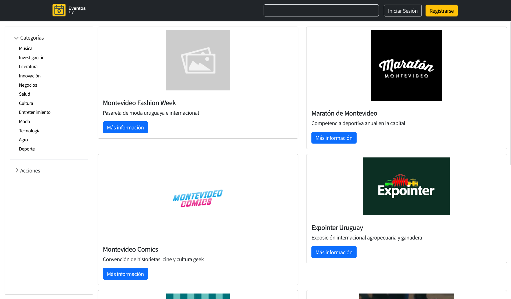
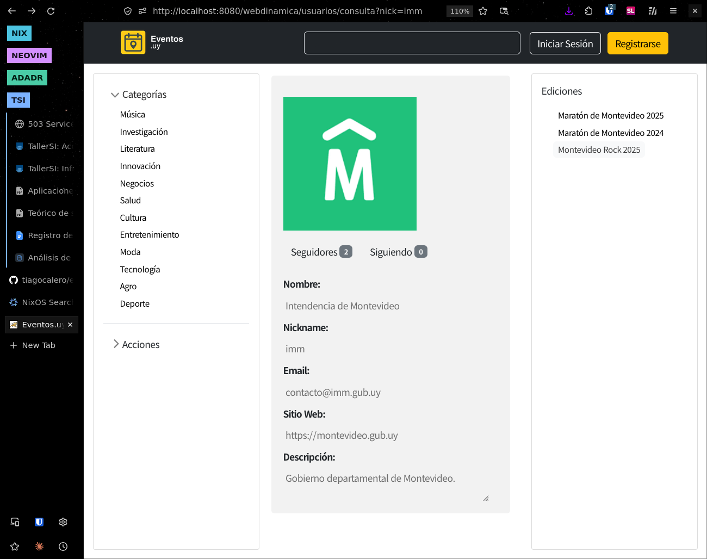
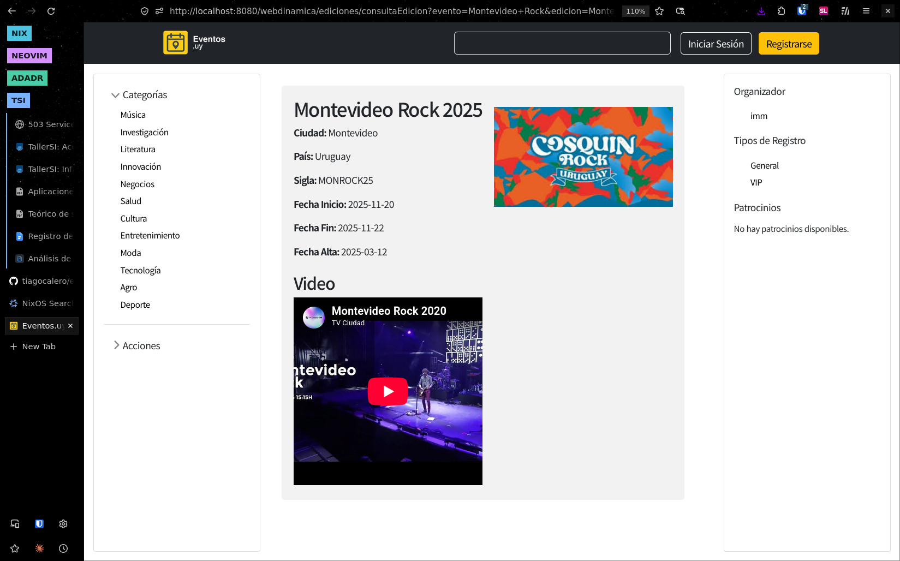
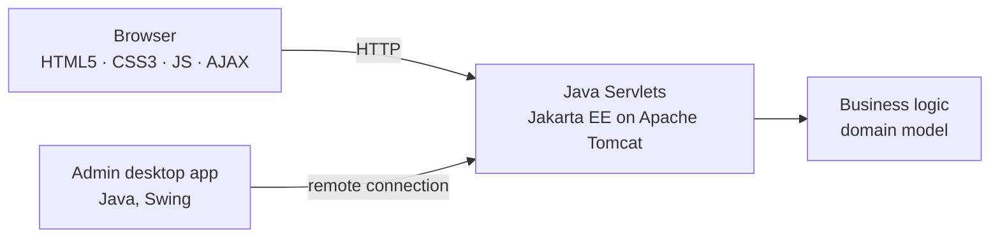

# Event Ticketing Platform

A full-stack web platform for managing events, editions, organizers, sponsoring institutions and ticket sales. With a companion Java desktop app for administrators that pushes privileged changes to the live site in real time.

> University project — Universidad de la República (UDELAR), team of 5.





## Features

- Browse events and their editions, each with an organizer and a sponsoring institution
- Buy and sell tickets per edition
- Dynamic pages with AJAX
- **Admin desktop app** (Java) connected remotely to the web server: privileged changes made there are reflected on the website in real time

## Architecture



**Domain model:** Event → Edition → Ticket, with Organizer and Sponsoring Institution.

## Tech stack

| Layer | Technologies |
|---|---|
| Backend | Java, Jakarta EE (Servlets), Apache Tomcat |
| Frontend | HTML5, CSS3, JavaScript, AJAX |
| Admin client | Java desktop application, Swing |

## Getting started

Dependencies to run the proyect:
- Java (version 21)
- Maven

To start, first download the latest release or the "entrega3" tag,
then you will find a `deploy.sh` executable script in the files, which automatically
compiles and runs everything and tells you all the information you need to know.
The app runs on http://localhost:8080/webdinamica
and http://localhost:8080/webmovil for the mobile app.
The script also prints instructions to run the admin desktop app, which are:
```bash
cd "<proyect-folder>/tpgr40"
java -cp "target/tpgr40-0.0.1-SNAPSHOT.jar:target/dependency/*" main.java.publicar.Main
```

Data is loaded dynamically for testing (no external database required). From the admin desktop app: Sistema → Cargar Datos.
