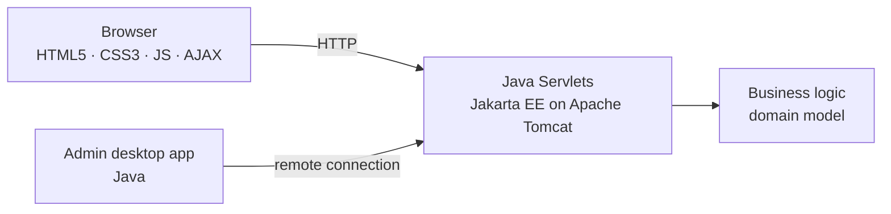

# Event Ticketing Platform

A full-stack web platform for managing events, editions, organizers, sponsoring institutions and ticket sales — with a companion Java desktop app for administrators that pushes privileged changes to the live site in real time.

> University project — Universidad de la República (UDELAR), team of 5.

<!-- TODO: add 2–3 screenshots here (home page, event detail, admin desktop app). Screenshots are the first thing a recruiter looks at. -->
<!--  -->

## Features

- Browse events and their editions, each with an organizer and a sponsoring institution
- Buy and sell tickets per edition
- Dynamic pages with AJAX (no full page reloads)
- **Admin desktop app** (Java) connected remotely to the web server: privileged changes made there are reflected on the website in real time

## Architecture



**Domain model:** Event → Edition → Ticket, with Organizer and Sponsoring Institution.

## Tech stack

| Layer | Technologies |
|---|---|
| Backend | Java, Jakarta EE (Servlets), Apache Tomcat |
| Frontend | HTML5, CSS3, JavaScript, AJAX |
| Admin client | Java desktop application |

## Getting started

```bash
# TODO: replace with the real build/run steps
git clone https://github.com/<your-user>/event-ticketing-platform.git
cd event-ticketing-platform
# build the WAR (e.g. mvn package) and deploy it to Tomcat
```

Data is loaded dynamically at startup for testing (no external database required).

## My contribution

<!-- TODO: be specific — this is what interviewers ask about. Example: -->
- Implemented <!-- e.g. the ticket purchase flow servlets and AJAX endpoints -->
- Built <!-- e.g. the remote connection between the desktop admin app and the server -->

## Team

Developed by a team of 5 students at UDELAR: <!-- teammates' GitHub handles, with their permission -->
